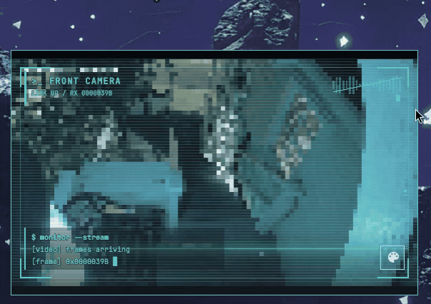

# RTSP Camera for Omarchy

View your RTSP cameras from the Omarchy bar in Omarchy Style, with live theme 
preview configurations, cool effects, overlays, and a pinnable, resizable viewer
that you can move around your screen and pin to stay on top of your other apps.

[](docs/assets/preview.mp4)

Pixelated camera feed with the Hackerman overlay.
[Watch the MP4 recording](docs/assets/preview.mp4).

Surveillance-camera icon in the Omarchy bar. Click to view; Config in the upper right
opens the camera name, RTSP address, username, and masked password form. Save & connect
persists that camera and opens its stream. Escape, the close button, clicking outside,
or clicking the bar icon closes the popup.

The top row has a camera dropdown alongside the pin and Config controls.
Select a name to switch feeds. Open **Config** and use **+** beside the camera
name field to add another named camera.
Selecting a camera in Config loads its settings without leaving the form.
Closing and reopening returns to the selected camera's main screen, discarding
unsaved Config edits. 

The last selection is remembered and shared across monitor widgets. Names must be unique 
(up to 64 characters), with up to 32 saved cameras. Switching cameras mutes audio and resets reconnect
attempts. 

Drag either bottom corner to resize the viewer; double-click a corner to
reset its size to 640×500. Dimensions are saved per stable camera ID in
`~/.config/rtsp-camera/view-<camera-id>.json` (or under `$XDG_CONFIG_HOME`),
shared across monitors. New cameras start at 640×500, not another camera's size.
Each open viewer keeps its own geometry: resizing one does not resize other
viewers, including duplicate pins of that camera. Reopening or switching back
restores that camera's saved dimensions, fitted within the current monitor.
Renaming retains geometry. Video retains its aspect ratio while resizing.

Turn on the square pin switch to keep the camera above other windows while using
your desktop. **Click the bar icon again to open a separate selectable viewer**;
each pinned viewer stays on its camera, so you can select and pin several cameras
concurrently. A fresh viewer automatically selects the first camera in saved-list
order that is not already pinned in this bar widget, skipping all its open pins.
With no pins, or when every camera is pinned, it keeps the remembered selection
(including a single-camera library). This choice runs once after the initial
settings load; subsequent dropdown choices, Config edits, and file reloads do not
reapply it. A pin's dropdown and add-camera button are disabled; unpin it to
switch cameras, or use the separate selectable viewer. Config still edits that
pin's profile. Renames and connection edits update its stable camera ID; deleting
that profile closes its pinned viewers rather than switching them to another camera.
Duplicate pins of the same camera are allowed (each uses its own decoder).
Unpinning restores popup mode and closes any existing selectable popup, but never
another pinned viewer. Close or Escape closes only that viewer. The bar and IPC
open/toggle operate on the selectable popup; IPC close/audio/resize/pin/status
use that popup, or the most recently created open pin when no popup exists.
Closed viewers stop playback immediately and are destroyed after pending settings
writes finish. Pins are session-only, not restored after restarting the shell.
While pinned, drag the empty header space to move the viewer anywhere
within the current screen. Unpinning returns it to the bar icon. The dragged
position is saved per camera and monitor in `position-<camera-id>--<monitor>.json`
under the camera config directory. Moving one open pin does not move the others;
new pins restore that camera's latest saved position on that monitor, including
after closing or restarting the shell, clamped to the current screen size.
A camera without a position on this monitor pins at the bar anchor. Camera IDs
and monitor names are filename-encoded (camera hyphens become `%2D` to keep the
separator unambiguous). Legacy `view.json` and `position-<monitor>.json` files
are left untouched and are not inherited by production viewers. Debounced writes
retain the original camera and monitor even when switching or closing quickly.
The pin switch itself resets when the viewer is closed.
While pinned, the surrounding panel and header fade out when the pointer leaves
the viewer, and fade back in on hover. The camera feed and its overlay controls
remain visible, with no change to the feed's size or position.

Streaming stops while closed or editing settings. Audio starts muted. In every
video style and overlay, click the top-right waveform to mute or unmute; its slash
indicates muted audio. The waveform button also supports keyboard focus and Space.
Closing the popup or opening settings mutes audio again. Streams without an audio track disable the
audio control. The bottom-right palette icon opens the video theme preview. Failed connections, interrupted
streams, and five seconds without video frames trigger automatic reconnect.
Retries wait 2, 4, 8, 16, then at most 30 seconds between attempts; each connection
has a 20-second timeout. Receiving video resets the delay. Closing the viewer or
opening settings cancels retries.

Connection status is shown by the corner borders and terminal readouts. The audio
waveform and theme button have transparent backgrounds and themed interaction
states. Controls overlay the feed.

## Requirements

- Omarchy 4 with its Quickshell plugin system and bundled shell components.
- Qt 6 Multimedia and a playback backend, such as `qt6-multimedia-ffmpeg`.
- Python 3; no pip packages are needed.
- An accessible RTSP/RTSPS camera and its stream path. Codec support depends on
  the installed [Qt Multimedia backend](https://doc.qt.io/qt-6/qtmultimedia-index.html).

Tested on Omarchy 4.0.3, Quickshell 0.3.1, and Qt 6.11.2. Icons use Omarchy's
configured Nerd Font. The plugin runs in the existing shell process and invokes
its bundled Python helper for settings; it installs no background service,
downloads no runtime code, and needs no root access. Dependencies must already
be installed. FFmpeg, QtTest, and Qt Shader Tools are development tools only
(the FFmpeg playback backend is still needed when chosen for playback).

## Video appearance

Click the **palette icon** at the bottom-right of the feed to open the theme
section below the video. Choose **Video style** and adjust its sliders while the
feed keeps playing; changes preview immediately in this viewer.

**Rotation · this camera** offers **0°**, **90° clockwise**, **180°**, and
**270° counterclockwise**. Rotation previews live and **Apply** remembers it for
the selected camera across monitors and restarts. Cameras without a saved rotation
use 0°. Renaming a camera keeps its rotation. The video keeps its proportions;
overlays and controls stay upright and inside the displayed image. Rotation uses
Qt's video renderer without re-encoding the stream.

The video styles are:

- **Original**: unfiltered video, with no effect texture allocated.
- **Omarchy** (first-run default): gently blends the image into the current Omarchy palette.
- **Pixel**: crisp blocks with original colors.
- **Omarchy Pixel**: combines the pixel look with the theme tint.

The themed styles show a **Tint strength** slider (default 35%). Zero preserves
the original colors; 100% fully maps the image into the theme palette. Theme
changes update the filter automatically. Text and video controls remain sharp.

**Pixel** and **Omarchy Pixel** show a **Pixel size** slider from 1 to 16 px.
Higher values make larger blocks and a stronger pixelated look. The default is
3 px, including for settings saved before this slider was added. Click **Apply**
to save the size for every camera and monitor.

Use **Overlay** to add a theme-colored camera display to any video style:

- **Default**: corner borders and the waveform mute button.
- **Coder**: Default plus right-side activity dots pulsing up and down and a lower
  terminal readout with stream status and a received-frame counter.
- **Hackerman**: Coder plus scanlines, a smooth scanning band sweeping down and back up
  every six seconds, a top terminal header, and a blinking block cursor.
  The top header is transparent. Coder and Hackerman show their lower console in
  larger viewers, beside the theme button, with a background at 39% opacity.

Corner borders are red while offline or connecting and return to the theme accent
when video frames arrive. They remain visible even before the first frame.
Existing saved video styles are preserved. Older overlay choices migrate from
Off to Default, Sci-fi HUD to Coder, and Hacker terminal to Hackerman.

Overlays preview and save with the other appearance settings. They fit the video
image, leaving letterboxing alone, and sit behind playback controls. They use
bounded geometry with no extra video capture texture or per-frame Python work.
The video border follows the theme accent. Playback controls stay inside the video
when resizing, inset from overlay corners, with transparent backgrounds.
The scan band uses a native looping animation. Coder and Hackerman share
one 8 Hz decoration clock and sample the frame counter once per second. The universal
waveform button has its own 8 Hz clock; it is simulated and never analyzes audio.
The Hackerman sweep pauses in place while offline and resumes when video returns.
Other decorations continue while visible. Hiding the overlay stops its animations,
and closing the viewer releases it. Default's corner borders need no animation clock.

Video style, tint, pixel size, and overlay apply to every camera and monitor;
rotation is saved per camera. These settings are stored in
`~/.config/rtsp-camera/appearance.json` (or under `$XDG_CONFIG_HOME`). **Apply** saves
the preview and completely hides the theme section, returning the space to the
video. Click the palette icon again to reopen it with the saved values. Dismissing
the section with that icon, closing the viewer, switching cameras, or opening camera **Config** discards
unapplied changes. Other monitors see only the applied settings. Theme controls no
longer appear in Config. Closing the viewer or opening Config unloads the effect;
opening the theme section keeps playback and audio running.

Effects use one GPU capture texture and one shader, with no Python frame processing
or transcoding. They add rendering work and video memory, and do not reduce stream
decoding cost. A working Qt Quick GPU backend is required for filtered styles.

## Install

Install and enable from the repository:

```sh
omarchy plugin add https://github.com/Yani3rt/rtsp-camera-plugin.git --enable
```

The camera icon appears in the right bar section. Click it to open settings,
enter a camera name and its address, then choose **Save & connect**. For example,
`rtsp://192.0.2.10:554/stream` illustrates the format; replace the IP and path
with your camera's values. Enter credentials in the separate fields, not in
the URL. The first configured feed uses the Omarchy video style and Default overlay.

To update a git-managed installation:

```sh
omarchy plugin update yani.camera
```

For local development, copy the repository into
`~/.config/omarchy/plugins/yani.camera/`, including the compiled `shaders/`
assets and license notices, then run `omarchy-shell shell rescanPlugins` and
`omarchy plugin enable yani.camera --section right`. If an older manual copy
already occupies that directory, move it to a backup outside `plugins/`
before installing the git-managed version.

Settings live at `$XDG_CONFIG_HOME/rtsp-camera/config.json` (normally
`~/.config/rtsp-camera/config.json`). The password is stored as plaintext
in a mode-0600 file, inside a mode-0700 directory created on first save.
Credentials are passed to the save helper over stdin, not command arguments.
They are percent-encoded into the playback URL in memory. The plugin displays
generic playback errors; avoid enabling Qt/FFmpeg debug logging with real
credentials, since the backend may log stream URLs. RTSP itself is not
encrypted; use RTSPS if supported by the camera.

## Clipboard security: partial lifecycle mitigation

The connection form is created lazily only for explicit **Config**, or after an
asynchronous settings read confirms a missing file or an empty camera library.
There are no editable native TextFields while viewing a saved camera, while the
initial saved-profile read is pending, or while closed. Cancel, successful save,
and close destroy the form; validation errors keep its draft available. A damaged
or unreadable settings file requires explicit **Config** to open its repair form.

**This is not a Qt vulnerability fix.** A safe, isolated offscreen probe confirmed
that the locally tested Qt **6.11.2** retrieves clipboard text implicitly when a
hidden editable TextInput receives a clipboard-change notification. A malicious
clipboard provider can supply excessive data or stall retrieval; hiding a native
field is not enough. The lazy form removes these four fields from the viewer's
object lifecycle but **Config and first-run setup remain exposed on unpatched Qt**.

Use a Qt Declarative package containing upstream commit
[`bcbfae6761016974d9185cecee333b5f7aaf0442`](https://code.qt.io/cgit/qt/qtdeclarative.git/commit/?id=bcbfae6761016974d9185cecee333b5f7aaf0442)
(or an equivalent distribution backport). It changes the implicit `canPaste`
check from reading clipboard `text()` to querying `hasText()`. Verify the package's
patch status rather than assuming a version number is safe. Neither this plugin
mitigation nor that change adds global clipboard byte/deadline bounds:
**explicit paste can still retrieve unbounded clipboard data**. Do not treat the
Loader or the lifecycle tests as proof of complete exploit prevention. No hostile
clipboard provider was exercised against the live desktop.

## Verify

```sh
omarchy plugin validate .
python3 -m unittest discover -s . -p 'test_*.py'
```

In an active Omarchy Wayland session, run the integration checks (requires
FFmpeg and QtTest). These use temporary settings, a refused localhost connection,
and generated video, without reading the saved camera credentials:

```sh
python3 tests/run_qml_checks.py
```

Use `python3 tests/run_qml_checks.py --lifecycle-only` for native editor object
lifecycle checks through the production Widget: saved-profile open before and
after the asynchronous read, Config focus/keyboard traversal and password masking,
draft preservation, validation failure, Cancel, save, Add, close, missing/empty
first-run libraries, and explicit repair of invalid settings. The default full
suite includes these checks. They count real instantiated editable controls,
including hidden ones; they are not a Qt patch test or a full clipboard exploit test.

For layout-only changes, use `python3 tests/run_qml_checks.py --ui-only` to skip
the playback recovery checks. This still checks rendered effect pixels, live palette
updates, appearance persistence, and the settings controls.

Use `python3 tests/run_qml_checks.py --pin-only` for the real Widget entry-point
checks: bar clicks, first-unpinned selection and fallbacks, simultaneous independent playback, fixed camera IDs, settings
selection, rename/delete and connection updates, duplicate pins, rotation/global
appearance, independent movement/audio, unpin/reopen, and dynamic viewer cleanup.
They also check per-camera size/position restoration, camera/monitor scope,
rapid switch/close writes, late-load user edits, legacy-file preservation, and
geometry restoration in a separate shell process.

Use `python3 tests/run_qml_checks.py --rotation-only` for rotation checks with a
generated four-color video, covering every video style, saved camera rotations,
preview cancellation, and resized controls.

`python3 tests/run_qml_checks.py --benchmark` compares process CPU usage and received
frame rate for all four styles using a generated 320×240, 10 fps clip. It is a small
local comparison, not a GPU benchmark or a guarantee for higher-resolution cameras.

The compiled Qt 6 shader is included, so installation needs no shader compiler.
After editing `shaders/video.frag`, rebuild it with Qt Shader Tools:

```sh
/usr/lib/qt6/bin/qsb --glsl '100 es,120,150' --hlsl 50 --msl 12 \
  -o shaders/video.frag.qsb shaders/video.frag
```

## Disable or remove

```sh
omarchy plugin disable yani.camera
```

To remove the plugin and its bar entry:

```sh
omarchy plugin remove yani.camera
```

Omarchy asks for confirmation. Disabling or removing the plugin retains your
camera profiles, credentials, appearance, and window settings in
`${XDG_CONFIG_HOME:-$HOME/.config}/rtsp-camera/`. To erase those as well, delete
that directory yourself after removal. No other application settings are stored
there. Installing the plugin does not overwrite existing camera settings.

## License

[MIT](LICENSE). The adapted Omarchy popup retains its original attribution in
[THIRD_PARTY_NOTICES.md](THIRD_PARTY_NOTICES.md). The preview recording and still
image show the owner's pixelated camera feed, shared with permission.

Marketplace submission steps and a prepared listing are in [PUBLISHING.md](PUBLISHING.md).
